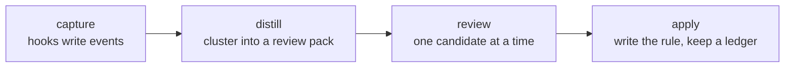

# claude-apprentice

A Claude Code plugin that learns how you work. It quietly collects your decisions, corrections and tone of voice during sessions. On demand it suggests CLAUDE.md and skill improvements, so Claude can work more autonomously. It only proposes: nothing is written to a rules file until you accept it.



## Install

From a checkout. The marketplace is named `vtrifonov` and the plugin `apprentice`, so the install key is `apprentice@vtrifonov`.

```
claude plugin marketplace add <path-to-checkout>
claude plugin install apprentice@vtrifonov
```

During development, add the marketplace from the worktree instead. The plugin then runs from that path, so only commit there when the test suite is green.

```
claude plugin marketplace add <path-to-worktree>
```

### Every profile

Each Claude Code profile (`~/.claude` and every `~/.claude-*`) enables plugins on its own, so repeat the step per profile.

Default profile (`~/.claude`). Unset the variable; do not set `CLAUDE_CONFIG_DIR=~/.claude`, which creates a stray `~/.claude/.claude.json`:

```
env -u CLAUDE_CONFIG_DIR claude plugin marketplace add <path>
env -u CLAUDE_CONFIG_DIR claude plugin install apprentice@vtrifonov
```

Every other profile:

```
CLAUDE_CONFIG_DIR=~/.claude-<name> claude plugin marketplace add <path>
CLAUDE_CONFIG_DIR=~/.claude-<name> claude plugin install apprentice@vtrifonov
```

A plain `install` enables the plugin for that profile. `/apprentice:status` lists every profile and prints the exact command for the ones that lack the plugin.

## Commands

| Command | Arguments | What it does |
|---|---|---|
| `/apprentice:status` | `[--full]` | Capture, backfill and per-profile status as Markdown. `--full` adds the detail sections. |
| `/apprentice:suggest` | `[--since YYYY-MM] [--repo owner/name] [--scope global\|repo\|skill] [--all] [--limit N] [--preclassify]` | Builds a review pack, then walks through the candidates one by one with the `apprentice:distill` skill. |
| `/apprentice:apply` | `--undo <id>` or `--replay` or `--id <id> --text-file <file> --scope <scope> --target <path> [--pack <json>] [--merged-ids a,b] [--confirm-tracked] [--dry-run]` | Writes, undoes or replays one rule in the marked apprentice section of a rules file. `suggest` calls it for you. |
| `/apprentice:tone` | `[--refresh]` | Builds the writing profile of the current account group and offers to install the tone pointer in the global CLAUDE.md. |
| `/apprentice:preclassify` | `[--since YYYY-MM] [--max-batches N]` | Opt-in. Sends correction pairs of the current profile to haiku so `suggest` groups them better. |
| `/apprentice:backfill` | `[--since YYYY-MM] [--project=<slug>] [--dry-run]` | Reads past transcripts in the background and adds the events the live hooks did not capture. One run at a time. |

There is also `scripts/ledger.py` (`record`, `show`), which the review skill uses to log outcomes other than accept.

## Data root

`~/.claude/apprentice/`, override with `APPRENTICE_HOME`. Directories are mode 0700, files 0600.

```
config.json            your settings (optional)
disabled               kill-switch marker file (optional)
hook-errors.log        one line per hook error, never payload text
events/YYYY-MM.jsonl   captured events, one JSON object per line
ledger/                review outcomes per rule id
review/                <pack>.json and <pack>.md written by suggest
profile/               tone-<group>.json and tone-<group>.md
backups/               copies of rules files taken before apply edits them
state/                 plugin-root, group-labels.json, backfill.log and lock,
                       last-sessionstart.json, pending-ask/, preclass/, tmp/,
                       pack-private/ (never opened by the model)
```

Event fields are in [docs/record-schema.md](docs/record-schema.md), hook input shapes in [docs/hook-payloads.md](docs/hook-payloads.md), open items in [docs/follow-ups.md](docs/follow-ups.md).

## Privacy

- Stored: AskUserQuestion questions, options and answers; your prompt text (at most 4 KB); and a short assistant text before a correction (at most 400 characters). Nothing else. No tool output, no file contents, no assistant replies.
- Every free-text field goes through a scrubber before it is written. Add your own regexes (employer, customer, service names) to `extra_redact_patterns`.
- Counts and aggregates use every profile. Verbatim text enters a review pack or a tone file only from the current account group, so one account's wording never shows up in another's.
- Emails stay on your machine. Anything that leaves it (preclassify, the review model) has them masked.
- Hooks never fail a session: they exit 0, print nothing except the two SessionStart cases, and log one line to `hook-errors.log`.

Rules for the `skill` scope may land in git-tracked files. Apprentice never commits them. A repo whose `CLAUDE.local.md` is committed gets no repo rules, because that file would publish them.

## Kill switch

Set `APPRENTICE_DISABLE=1` in the environment, or create the file `<home>/disabled`. Hooks then do nothing. `/apprentice:status` shows `disabled` and the way to undo it.

## Interpreter

Hooks and scripts run `${APPRENTICE_PYTHON:-/usr/bin/python3}` with `-I -S`. They need Python 3.9 or newer and the standard library only.

On macOS, `/usr/bin/python3` is a stub until the Command Line Tools are installed. Without them the hooks silently stop, and `/apprentice:status` reports "interpreter missing". Fix it with `xcode-select --install`, or point `APPRENTICE_PYTHON` at a Python 3.9+ interpreter.

Cost, measured under load (quiet-machine C2 pending): post-tool hook median 56.2 ms against a 44.2 ms bare-interpreter baseline, user-prompt 56.5 ms against 44.7 ms, so about 12 ms per hook on top of Python start-up. Both hooks run async and never block a prompt.

## Configuration

`<home>/config.json`. Every key is optional; a malformed value is ignored with one log line a day, and the default applies.

```json
{
  "account_groups": {"<group A>": ["<profile 1>", "<profile 2>"], "<group B>": ["default"]},
  "unknown_group": "<group A>"
}
```

Real group, profile and employer names never go into a committed file. Keep config.json out of any repo.

| Key | Default | Meaning |
|---|---|---|
| `account_groups` | `{}` | Group name to the profile names it holds. A profile in no group is its own implicit group with an opaque label `group-<n>`, never its directory name. |
| `unknown_group` | none | Group that backfilled `unknown` events belong to. Unset means they belong to no group, so their text is withheld from every session. |
| `profile_rules` | `[]` | Optional. Rules that let backfill assign a profile to a transcript by its working directory. Without them the newest-transcript column in status is global. |
| `public_skills` | `[]` | Skill directory names whose content you mirror to a public place by hand. Rules for them are treated as public. |
| `capture_entrypoints` | `["cli", "claude-desktop"]` | Entrypoints the hooks capture. Headless `sdk-cli` sessions are skipped. |
| `retention_months` | `24` | Event files older than this many months are deleted at session start and skipped by backfill. |
| `extra_redact_patterns` | `[]` | Extra regexes the scrubber and the apply check treat as sensitive. |
| `display_name` | `the user` | Name the tone pointer uses. Set by the `/apprentice:tone` picker. |
| `own_email_domains` | `[]` | Email domains the scrubber treats as your own. |
| `skill_hints`, `number_patterns`, `header_aliases`, `risk_words`, `phase_words` | built-in | Extend the built-in tables used to attribute and classify questions. |
| `worktree_suffix` | `-worktrees` | Suffix of the worktree parent directory in a `<parent>/<name><suffix>/<dir>` layout, used to find the main checkout of a deleted worktree. |

## Tone file

`/apprentice:tone` writes `profile/tone-<group>.md` for the current account group only. A session reaches it through its SessionStart line, which names the file for that session's own group and no other. The tone pointer rule in the global CLAUDE.md tells Claude to read that file only when the line is present. SessionStart output does reach the session in the CLI, so the pointer and the picker ship. Where it does not, mention the file by hand (V7, pending C5).

## Development

```
/usr/bin/python3 -m unittest discover -s tests -t .
```

The suite includes a privacy test over every committed file and a static gate for the Python 3.9 floor and the hook-path import list. Fixtures are synthetic: `acme/widgets`, `XX-123`, Alice and Bob.
