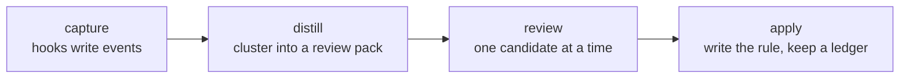

# claude-apprentice

A Claude Code plugin that learns how you work. It quietly collects your decisions, corrections and tone of voice during sessions. On demand it suggests CLAUDE.md and skill improvements, so Claude can work more autonomously. It only proposes: nothing is written to a rules file until you accept it.

## The idea

Every time Claude asks you something, and every time you correct it, you teach it something. Then the session ends and the lesson is gone. Next week you answer the same question the same way, and type the same correction again.

claude-apprentice keeps those lessons. It records the small, repeated signals:

- the answers you give to `AskUserQuestion` pickers;
- whether you take the "(Recommended)" option;
- the prompts where you push back on what Claude just did;
- how you write.

When you ask, it turns the patterns into concrete rule proposals. You review them one at a time. Accepted rules go into the right file:

- your global CLAUDE.md;
- a repo's personal `CLAUDE.local.md`;
- the `SKILL.md` of the skill that keeps asking.

Typical outcomes:

- **A skill stops asking a question you always answer the same way.** Example: *Default to quick mode without asking; ask only when auth, persistence or deploy is in play.*
- **A correction becomes a standing rule.** Example: *Never run e2e tests unless asked; the unit suite is the gate.*
- **A tone file teaches Claude how you write.** Drafts in your voice sound like you, and replies to you match how you read.

## How it works



1. **Capture (always on, silent).** Plugin hooks on `SessionStart`, `UserPromptSubmit`, `PreToolUse` and `PostToolUse` append small JSON events to `~/.claude/apprentice/events/`. They capture:
   - each AskUserQuestion with its options and your answer, including Other text and rejected pickers;
   - each prompt you type, with the last 400 characters of Claude's reply before it, so a correction keeps its context.

   Text is scrubbed of secrets before it is written. The capture hooks run async, cost about 20 ms on top of Python start-up, and never fail or block a session. `/apprentice:backfill` reads your past transcripts once, so you start with history instead of an empty log.
2. **Distill (on demand, local).** `/apprentice:suggest` runs a stdlib-only Python pass over the events and builds a review pack:
   - Questions are clustered by their normalized wording. For each cluster it measures how consistently you answer and whether you follow the recommendation.
   - When your answer depends on something, a decision split finds the condition, such as the repo, the weekday or a file count, and the rule is worded conditionally.
   - Prompts that push back on Claude's previous turn are grouped by topic into correction candidates.
   - Each candidate gets a confidence band (high, medium or low) from its sample size and from how many separate sessions and days back it up.
   - Each candidate also gets a proposed target file.
3. **Review (you decide).** The `apprentice:distill` skill words each candidate as a short rule in the style of your CLAUDE.md. It shows the evidence and asks one picker: Accept, Decline, Later, or Edit or rescope.
   - A declined candidate stays hidden until new evidence arrives: at least three new events, or as many as it had when you declined it, whichever is more.
   - Later hides a candidate for 14 days from the decision, however much new evidence arrives.
   - Every decision is logged in a ledger.
4. **Apply (safe writes).** Accepted rules go into a marked `<!-- apprentice:start -->` / `<!-- apprentice:end -->` section, one line per rule, each tagged with a stable id.
   - A backup is taken before every edit.
   - A file tracked in git is written only after you see the diff and confirm it; nothing is ever committed.
   - `--undo <id>` removes a rule, and `--replay` restores rules after a file was reset.
   - Repo rules go to the main checkout's `CLAUDE.local.md`. That file is added to `.git/info/exclude` and symlinked into worktrees.

Two optional extras:

- **`/apprentice:tone`** measures how you write: message length, registers, openers, punctuation, recurring spelling patterns, and an estimated proficiency band. It writes a tone file with real examples. A one-line pointer in your global CLAUDE.md tells Claude to use it when drafting as you or answering you.
- **`/apprentice:preclassify`** sends correction pairs to haiku, so similar corrections group better. It sends only live-captured prompts of the current profile that distill could use (never pasted, duplicate or backfilled ones). It runs with `--safe-mode`, no tools and no saved session.

## Requirements

- Claude Code with plugin support.
- macOS or Linux with Python 3.9 or newer at `/usr/bin/python3`, or at `APPRENTICE_PYTHON`. Standard library only, with nothing to `pip install`. On macOS, install the Command Line Tools (`xcode-select --install`).

## Quick start

The repository is private for now, so you need read access to it.

```
claude plugin marketplace add vtrifonov/claude-apprentice
claude plugin install apprentice@vtrifonov
```

Or from a local clone:

```
git clone https://github.com/vtrifonov/claude-apprentice.git
claude plugin marketplace add ./claude-apprentice
claude plugin install apprentice@vtrifonov
```

Then, in a new session:

1. `/apprentice:status` checks that capture works and lists any profile still missing the plugin.
2. `/apprentice:backfill` imports your past transcripts in the background. Check its progress in `/apprentice:status`.
3. If you use several Claude Code profiles (`CLAUDE_CONFIG_DIR`), decide which ones may see each other's text, and set `account_groups` and `unknown_group` in `~/.claude/apprentice/config.json`. See [Configuration](#configuration). Backfill reads every profile's `projects/`. Transcripts in a `projects/` directory only one profile uses belong to that profile. Transcripts in a directory several profiles share (through a symlink) are `unknown`, unless `profile_rules` match them. Without `unknown_group`, the text of `unknown` events is withheld and packs show counts only.
4. `/apprentice:suggest` reviews the first candidates.
5. Optionally, run `/apprentice:tone` once you have a few hundred prompts.

Use it for a week or two, then run `/apprentice:suggest` again. The useful patterns are the ones that repeat.

## Install details

The marketplace is named `vtrifonov` and the plugin `apprentice`, so the install key is `apprentice@vtrifonov`.

During development, add the marketplace from a local checkout or worktree. The plugin then runs from that path, so only commit there when the test suite is green.

```
claude plugin marketplace add <path-to-checkout>
```

### Every profile

Each Claude Code profile (`~/.claude` and every `~/.claude-*`) enables plugins on its own, so repeat the step per profile.

Default profile (`~/.claude`). Unset the variable; do not set `CLAUDE_CONFIG_DIR=~/.claude`, which creates a stray `~/.claude/.claude.json`:

```
env -u CLAUDE_CONFIG_DIR claude plugin marketplace add <path>
env -u CLAUDE_CONFIG_DIR claude plugin install apprentice@vtrifonov
```

Every other profile:

```
CLAUDE_CONFIG_DIR=~/.claude-<name> claude plugin marketplace add <path>
CLAUDE_CONFIG_DIR=~/.claude-<name> claude plugin install apprentice@vtrifonov
```

A plain `install` enables the plugin for that profile. `/apprentice:status` lists every profile by the name `account_groups` uses and prints the exact commands for the ones that lack the plugin: `marketplace add` then `install`, or `claude plugin enable apprentice@vtrifonov` for a profile where the plugin is installed but disabled.

## Commands

| Command | Arguments | What it does |
|---|---|---|
| `/apprentice:status` | `[--full]` | Capture, backfill and per-profile status as Markdown. `--full` adds the detail sections. |
| `/apprentice:suggest` | `[--since YYYY-MM] [--repo owner/name] [--scope global\|repo\|skill] [--all] [--limit N] [--preclassify]` | Builds a review pack, then walks through the candidates one by one with the `apprentice:distill` skill. |
| `/apprentice:apply` | `--undo <id>` or `--replay` or `--id <id> --text-file <file> --scope <scope> --target <path> [--pack <json>] [--merged-ids a,b] [--confirm-tracked] [--dry-run]` | Writes, undoes or replays one rule in the marked apprentice section of a rules file. `suggest` calls it for you. |
| `/apprentice:tone` | `[--refresh]` | Builds the writing profile of the current account group and offers to install the tone pointer in the global CLAUDE.md. |
| `/apprentice:preclassify` | `[--since YYYY-MM] [--max-batches N]` | Opt-in. Sends correction pairs of the current profile to haiku so `suggest` groups them better. |
| `/apprentice:backfill` | `[--since YYYY-MM] [--project=<slug>] [--dry-run]` | Reads past transcripts in the background and adds the events the live hooks did not capture. One run at a time. |

The review skill also calls `scripts/ledger.py record` to log outcomes other than accept. `scripts/ledger.py show --id <id>` is for manual inspection only; no command or skill runs it. It prints that id's ledger entries without the sidecar fields, and blanks `text`, `user_edit` and `reason` in entries recorded by another account group.

Text never goes on a command line. The skill and `/apprentice:tone` Write it to a file under `<home>/state/tmp/` and pass the path (`--text-file`, `--user-edit-file`, `--set-model`, `--display-name-file`); any other path is refused. File names start with the group tag that `distill.py` and `tone.py` print on their `group=<tag>` line, for example `<tag>-<id>.txt`. Each script deletes its file once read (apply keeps it after a `--dry-run`, for the real apply that follows), and `distill.py` and `tone.py` delete any file in `state/tmp/` older than an hour when they start.

## Data root

`~/.claude/apprentice/`, override with `APPRENTICE_HOME`. Directories are mode 0700, files 0600.

```
config.json            your settings (optional)
disabled               kill-switch marker file (optional)
hook-errors.log        one line per hook error, never payload text
events/YYYY-MM.jsonl   captured events, one JSON object per line
ledger/                proposals.jsonl (review decisions) and applied.jsonl
                       (apply, undo, replay and CLAUDE.local.md link rows)
review/                <pack>.json and <pack>.md written by suggest
profile/               tone-<group>.json and tone-<group>.md
backups/               copies of rules files taken before apply edits them
state/                 plugin-root, group-labels.json, backfill.log and lock,
                       last-sessionstart.json, pending-ask/, preclass/, tmp/,
                       pack-private/ (never opened by the model)
```

Event fields are in [docs/record-schema.md](docs/record-schema.md), hook input shapes in [docs/hook-payloads.md](docs/hook-payloads.md).

## Privacy

- Stored: AskUserQuestion questions, options and answers; your prompt text; and the end of the assistant text before each prompt (at most 400 characters). Nothing else. No tool output, no file contents, no assistant replies.
- A typed prompt is stored up to 1,500 characters. A longer prompt, a wrapped paste, or a prompt with three or more quote, code-fence or stack-trace lines counts as pasted: only its first 300 characters are stored, and distill and tone skip it.
- Every free-text field goes through a scrubber before it is written. The whole text is scrubbed before it is cut to its limit, so a secret that straddles the cut is still caught. Add your own regexes (employer, customer, service names) to `extra_redact_patterns`; they match case-insensitively.
- Events stored before the scrub-then-cut fix may hold the start of a secret at the end of a cut prompt. `scripts/rescrub.py` re-scrubs the stored events once and replaces such a prompt text whole. It is a dry run that prints counts; `--apply` rewrites the event files. Run it while no session is active.
- Prompts you did not type are never stored: relayed agent messages, expanded skill bodies, task notifications and usage-limit notes. Add your own with `machine_prompt_patterns`.
- Counts and aggregates use every profile. Verbatim text enters a review pack or a tone file only from the current account group, so one account's wording never shows up in another's.
- Emails and UUIDs stay on your machine. Anything that leaves it (preclassify, the review model) has them masked, and so does accepted rule text before apply writes it.
- Hooks never fail a session: they exit 0, print nothing except the two SessionStart cases, and log one line to `hook-errors.log`.

Rules may land in git-tracked files: a skill's `SKILL.md`, or the global CLAUDE.md when it lives in a git work tree (for example symlinked into a config repo). Apply writes a tracked file only after you confirm it (`--confirm-tracked`), having seen the tracking line and the diff, and never commits it. A repo whose `CLAUDE.local.md` is committed gets no repo rules, because that file would publish them.

## Kill switch

Set `APPRENTICE_DISABLE=1` in the environment, or create the file `<home>/disabled`. Hooks then do nothing. `/apprentice:status` shows `disabled` and the way to undo it.

## Interpreter

Hooks and scripts run `${APPRENTICE_PYTHON:-/usr/bin/python3}` with `-I -S`. They need Python 3.9 or newer and the standard library only.

On macOS, `/usr/bin/python3` is a stub until the Command Line Tools are installed. Without them the hooks silently stop, and `/apprentice:status` reports "interpreter missing". Fix it with `xcode-select --install`, or point `APPRENTICE_PYTHON` at a Python 3.9+ interpreter.

Cost, measured on a quiet machine (user-prompt hook, median of 30 runs after 3 warm-ups):

| Interpreter | Bare start | 2,000-line transcript | 84 MB transcript | Missing transcript |
|---|---|---|---|---|
| `/usr/bin/python3` (Command Line Tools) | 52.5 ms | 68.4 ms | 66.8 ms | 68.4 ms |
| Homebrew `python3` | 37.0 ms | 63.8 ms | 56.2 ms | 54.8 ms |

The hook adds 16–27 ms over interpreter start-up, and transcript size does not matter because only the tail is read. Both capture hooks run async and never block a prompt.

## Known limits

- **Settings-based auth in preclassify.** The preclassify child runs with `--safe-mode`, which probably skips auth that comes from settings (`apiKeyHelper`, an `env` block). If every batch fails with "child failed under --safe-mode", that is the cause. OAuth logins work.
- **The scrubber misses some sensitive text.** Person names, internal hostnames and lowercase ticket keys pass. List them in `extra_redact_patterns`.
- **Shared `projects/` directories.** Backfilled transcripts from a `projects/` directory that several profiles share cannot be told apart, so they are `unknown`. Set `unknown_group` to the group they belong to.
- **Desktop app.** Capture from the Desktop app (`claude-desktop` entrypoint) is enabled but not yet verified live.
- **Machine prompts in old data.** Builds before the machine-prompt filter stored relayed agent messages and similar text. The read-time filter hides them; they still take space in `events/`.

## Configuration

`<home>/config.json`. Every key is optional; a malformed value is ignored with one log line a day, and the default applies.

```json
{
  "account_groups": {"<group A>": ["<profile 1>", "<profile 2>"], "<group B>": ["default"]},
  "unknown_group": "<group A>",
  "machine_prompt_patterns": ["^Heartbeat for "]
}
```

Real group, profile and employer names never go into a committed file. Keep config.json out of any repo.

A profile name is the profile directory's basename: `default` for `~/.claude`, `.claude-work` for `~/.claude-work`. It is the name in the `/apprentice:status` profile table, and the one to list in `account_groups`.

| Key | Default | Meaning |
|---|---|---|
| `account_groups` | `{}` | Group name to the profile names it holds (`default`, `.claude-work`, …). A profile in no group is its own implicit group with an opaque label `group-<n>`, never its directory name. |
| `unknown_group` | none | Group that backfilled `unknown` events belong to: transcripts from a `projects/` directory several profiles share. Unset means they belong to no group, so their text is withheld from every session. |
| `profile_rules` | `[]` | Optional. Rules that let backfill assign a profile to a transcript in a shared `projects/` directory by its working directory. Without them the newest-transcript column in status is global. |
| `public_skills` | `[]` | Skill directory names whose content you mirror to a public place by hand. Rules for them are treated as public. |
| `capture_entrypoints` | `["cli", "claude-desktop"]` | Entrypoints the hooks capture. Headless `sdk-cli` sessions are skipped. |
| `retention_months` | `24` | Event files older than this many months are deleted at session start and skipped by backfill. So are review packs, their private sidecars, preclassify verdicts and backups last modified before that cutoff. The ledger is kept. `0` keeps everything. |
| `extra_redact_patterns` | `[]` | Extra regexes the scrubber and the apply check treat as sensitive. They match case-insensitively. An entry that does not compile is ignored, logged once a day and counted in `/apprentice:status`. |
| `machine_prompt_patterns` | `[]` | Extra regexes for prompts you did not type (searched in the stripped prompt text). A match is never stored, and stored matches are skipped by distill, tone and preclassify. Relayed agent messages, skill bodies, task notifications and usage-limit notes are built in. Example: `["^Heartbeat for "]` for prompts a scheduled wakeup replays. |
| `display_name` | `the user` | Name the tone pointer uses. Set by the `/apprentice:tone` picker while unset; a non-string value counts as unset. |
| `own_email_domains` | `[]` | Email domains the scrubber treats as your own. |
| `skill_hints`, `number_patterns`, `header_aliases`, `risk_words`, `phase_words` | built-in | Extend the built-in tables used to attribute and classify questions. |
| `worktree_suffix` | `-worktrees` | Suffix of the worktree parent directory in a `<parent>/<name><suffix>/<dir>` layout, used to find the main checkout of a deleted worktree. |

## Tone file

`/apprentice:tone` writes `profile/tone-<group>.md` for the current account group only. A session reaches it through its SessionStart line, which names the file for that session's own group and no other. The tone pointer rule in the global CLAUDE.md tells Claude to read that file only when the line is present. SessionStart output reaches the session in the CLI. Where the line does not arrive, mention the file by hand.

The command installs the pointer with `tone.py --install-pointer`. It first runs `--install-pointer --dry-run` and shows the diff. When the global CLAUDE.md is inside a git work tree, the picker offers `Install into the tracked file` (recommended only for a private remote) and then installs with `--confirm-tracked`. A missing global CLAUDE.md is created (mode 0600) with the apprentice section. A display name typed into the picker's Other field is stored only while none is set, through a file (`--display-name-file`), never as a command-line argument; with a name already set, Other text is answered as a reply and nothing is installed. Installing twice gives `result=unchanged`.

## Development

```
/usr/bin/python3 -m unittest discover -s tests -t .
```

The suite includes a privacy test over every committed file and a static gate for the Python 3.9 floor and the hook-path import list. Fixtures are synthetic: `acme/widgets`, `XX-123`, Alice and Bob.
